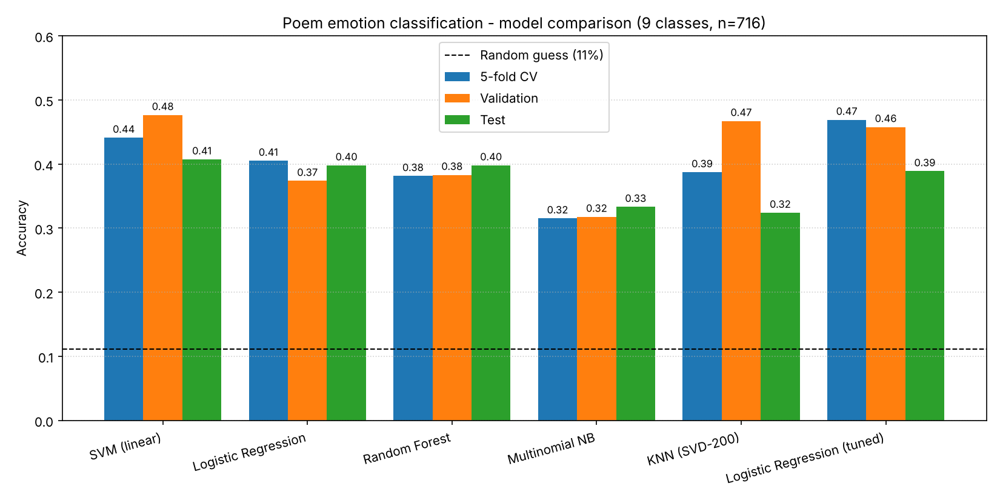

# 🎭 Sentiment & Emotion Analysis of English Poetry — A Comparative Study of ML Models

Classifying English poems into **9 emotion categories** (anger, courage, fear, hate, joy, love, peace, sad, surprise) and comparing how well classical machine-learning models handle this difficult, subjective task.



---

## 📌 Overview

Poetry is hard for NLP: language is figurative, short on explicit sentiment words, and the same poem can evoke several emotions. This project builds a text-classification pipeline on a labelled poetry corpus and **compares five classical models** (plus a tuned Logistic Regression and SVM experiments) using the same preprocessing, features and data splits, so the comparison is fair.

**Key goals**
- Build a clean preprocessing + TF-IDF feature pipeline for poems
- Compare SVM, Logistic Regression, Random Forest, Naive Bayes and KNN
- Tune hyperparameters with cross-validated grid search
- Analyse per-emotion performance and confusion patterns

---

## 📂 Repository Structure

```
poetry-emotion-classification/
├── data/
│   ├── PERC_mendelly.csv                   # 716 poems used in all experiments
│   └── Poetry_Dataset_extended.csv         # 2,527 poems (unused, for future work)
├── notebooks/
│   ├── 01_multi_model_comparison.ipynb     # 5-model baseline comparison + tuned SVM / RF
│   ├── 02_logistic_regression_tuned.ipynb  # Logistic Regression with GridSearchCV
│   └── 03_svm_experiments.ipynb            # Linear SVM experiments
├── results/
│   ├── results.csv                         # Metrics table (source for the chart)
│   └── model_comparison.png
├── make_chart.py                           # Regenerates the comparison chart
├── requirements.txt
├── LICENSE
└── README.md
```

---

## 📊 Dataset

| | |
|---|---|
| **File used in all experiments** | `data/PERC_mendelly.csv` (716 poems) |
| **Columns** | `Poem` (full text, may be multi-line), `Emotion` (label) |
| **Encoding** | Windows-1252 / Latin-1 (not UTF-8) — load with `encoding="cp1252"` |
| **Classes** | anger, courage, fear, hate, joy, love, peace, sad, surprise |
| **Extra file** | `data/Poetry_Dataset_extended.csv` — 2,527 poems; contains the 716 above plus 1,811 more with capitalised labels (`Peace`, `Sad`, …). Not used in the reported results. |

```python
import pandas as pd
df = pd.read_csv("data/PERC_mendelly.csv", encoding="cp1252")   # 716 rows, 9 classes
```

The corpus has 4 duplicate poems; they were not removed in the original experiments.

**Class distribution (716-poem subset):** love 161 · sad 154 · joy 128 · peace 80 · courage 77 · anger 46 · fear 31 · hate 23 · surprise 16 — the dataset is **imbalanced**, which strongly affects the rare classes.

---

## ⚙️ Methodology

### 1. Preprocessing
- Lower-casing
- Removing bracketed text and URLs
- Keeping alphabetic characters only
- NLTK English stop-word removal; dropping single-character tokens

### 2. Feature extraction
- **TF-IDF** (uni- and bi-grams, up to 20,000 features) — fitted on the training set only (no leakage)
- **KNN / tuned models:** TF-IDF → `TruncatedSVD` (200–300 components) → optional `StandardScaler`
- **Tuned SVM / RF (notebook 01):** combined word-level (1–2 gram) + character-level (3–5 gram) TF-IDF
- **Tuned LR (notebook 02):** 1–3 gram TF-IDF (`min_df=2`, `max_df=0.85`)

### 3. Data split
Stratified **70 / 15 / 15** train / validation / test split (`random_state=42`) → 501 / 107 / 108 poems.

### 4. Models compared
| Model | Configuration |
|---|---|
| SVM | `SVC(kernel="linear", C=1)` |
| Logistic Regression | multinomial, `saga`, `C=1` |
| Random Forest | 200 trees |
| Multinomial Naive Bayes | `alpha=1.0` |
| KNN | `k=5` on SVD-reduced features |
| Logistic Regression (tuned) | SVD(300) → StandardScaler → LR; `GridSearchCV` over `C`, solver; best `C=10`, `saga`, balanced class weights |

Evaluation: accuracy, per-class precision / recall / F1, confusion matrices, and 5-fold cross-validation on the training set.

---

## 🏆 Results

All numbers are from the notebook outputs (n = 716, test set = 108 poems).

| Model | 5-fold CV | Train | Validation | **Test** |
|---|---:|---:|---:|---:|
| **SVM (linear)** | 0.441 | 0.988 | **0.477** | **0.407** |
| Logistic Regression | 0.405 | 0.860 | 0.374 | 0.398 |
| Random Forest | 0.381 | 0.994 | 0.383 | 0.398 |
| Multinomial NB | 0.315 | 0.703 | 0.318 | 0.333 |
| KNN (SVD-200) | 0.387 | 0.593 | 0.467 | 0.324 |
| Logistic Regression (tuned) | **0.469** | – | 0.458 | 0.389 |

*Random guessing over 9 classes ≈ 11 %; always predicting the majority class ("love") ≈ 22 %.*

Other recorded runs:
- **Tuned SVM (RBF, SVD pipeline, notebook 01):** best CV accuracy 0.445 (`C=16`, `gamma=0.001`, 200 SVD components); with combined word+char TF-IDF the best CV was 0.355 (`C=2`, `gamma=0.001`).
- **SVM, simple 80/20 split (notebook 03):** 0.493 validation accuracy on 144 poems (non-stratified, so not directly comparable to the table above).

### Per-emotion findings (baseline linear SVM, test set)
- **Best:** `courage` (F1 0.63) and `love` (F1 0.50), the classes with clear lexical cues
- **Hard:** `joy` (F1 0.20) and `anger` (0.25), and especially `fear`, `hate` and `surprise` (F1 = 0) — these rare classes have only 2–7 test examples
- **Dominant confusion:** poems are frequently predicted as **`love`** or **`sad`**, the two largest classes, and `joy ↔ love ↔ sad` are mutually confused

### Takeaways
1. **Linear models (SVM / LR) beat tree-based, instance-based and probabilistic models** on sparse TF-IDF features.
2. **All models overfit heavily** — e.g. SVM and Random Forest reach ~99 % train accuracy versus ~40 % on test — which is expected with ~500 training poems and 20k features.
3. **Hyper-parameter tuning raised CV scores but not test scores** (tuned LR: 0.469 CV → 0.389 test), a sign that gains are within noise on such a small test set (on 108 poems, 5 poems ≈ 4.6 percentage points).
4. **Test-set differences between the top models (0.39–0.41) are not statistically meaningful** — validation and test rankings disagree (e.g. KNN is 2nd on validation but last on test).
5. **Class imbalance and label subjectivity are the main bottlenecks**, not model choice. Poem emotion is inherently ambiguous and bag-of-words features cannot capture metaphor or context.

---

## 🚀 Getting Started

### Install
```bash
git clone https://github.com/<your-username>/poetry-emotion-classification.git
cd poetry-emotion-classification
python -m venv .venv && source .venv/bin/activate   # Windows: .venv\Scripts\activate
pip install -r requirements.txt
python -c "import nltk; nltk.download('stopwords')"
```

### Run the notebooks
The notebooks were written in **Google Colab** and load the data from Google Drive. To run them, either:

- **Locally:** remove the `drive.mount(...)` cell and set
  ```python
  FILE_PATH = "data/PERC_mendelly.csv"
  ```
  (the notebooks fall back to Latin-1 automatically when UTF-8 fails). Also change the `joblib.dump(...)` paths in notebook 01 to a local folder.
- **In Colab:** upload the CSV to Google Drive and update `FILE_PATH`.

Note: notebooks 01 and 02 read the text column as `Poem` (notebook 01 has a fallback for a column named `peom`).

### Predict the emotion of a new poem
Each notebook ends with a `predict_emotion()` helper, e.g.:
```python
predict_emotion("The rain falls slow, my heart feels cold, in silence deep, my tears unfold.", ...)
```

---

## 🔮 Future Work
- Use the **extended 2,527-poem file** (normalise label case, remove duplicate poems)
- Handle imbalance: class weights, oversampling (SMOTE), or merging very rare classes
- **Bi-LSTM / Transformer models** (BERT, RoBERTa, DistilBERT) fine-tuned for emotion
- Pre-trained embeddings (GloVe, Word2Vec, sentence-transformers) as features
- Repeated stratified CV or bootstrapped confidence intervals for reliable model comparison
- Poetry-specific features: line count, rhyme, repetition, sentiment lexicons (NRC Emotion Lexicon)
- Multi-label classification, since poems often express more than one emotion

---

## 🛠️ Tech Stack
Python · pandas · NumPy · scikit-learn · NLTK · SciPy · Matplotlib · Jupyter / Google Colab

---

## 📄 License
Released under the [MIT License](LICENSE).

## 🙋 Author
Konain Fatima — [GitHub](https://github.com/Nianok-amitaf) 

*If you find this project useful, consider giving it a ⭐!*
